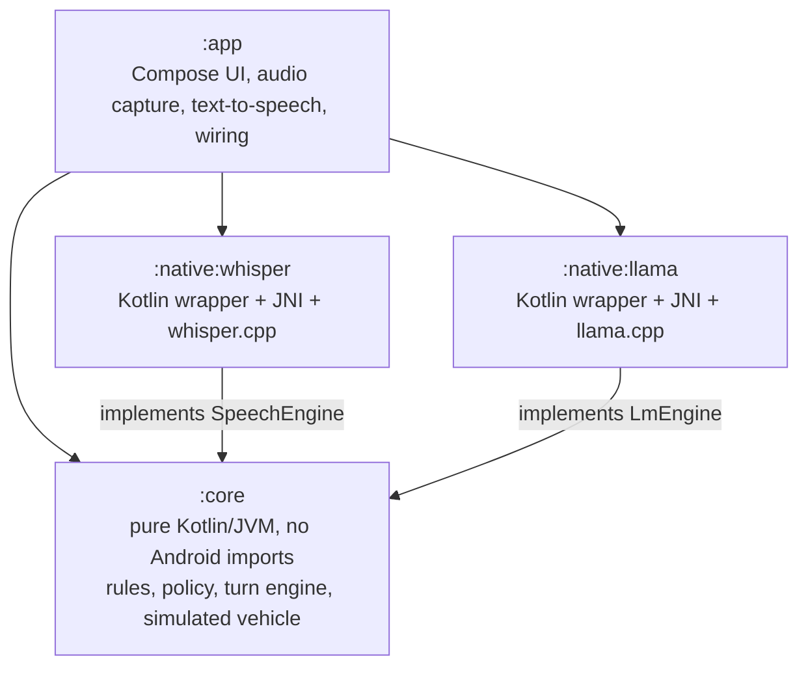
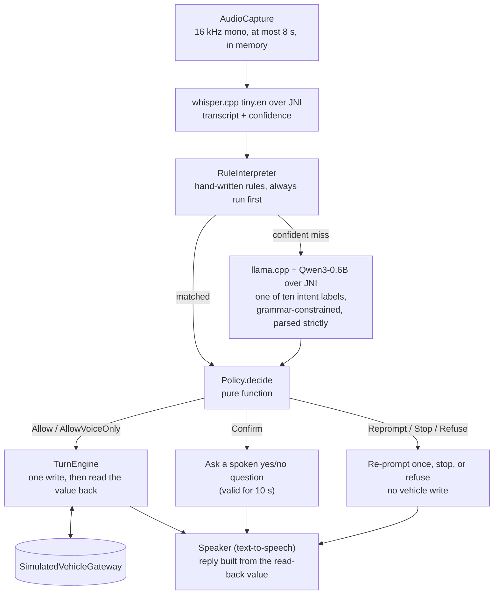

# Architecture

How Earshot is put together at v0.2.1: the modules, what happens in one turn, and where each
decision is made. This phase runs on the arm64 API 36 phone emulator against a simulated vehicle;
nothing here has run in a car. The reasons behind the choices are in the
[decision records](adr/README.md).

## Modules

Four Gradle modules. Arrows point from a module to the module it depends on.

- **`:core`** holds every decision: the command types, the rules, the language-model wire format,
  the policy, the turn engine, the simulated vehicle, model checks and traces. It has no Android
  imports, so all of its unit tests run on the JVM in CI, with no emulator and no native build.
- **`:native:whisper`** and **`:native:llama`** each wrap one C++ engine behind an interface that
  `:core` defines (`SpeechEngine`, `LmEngine`). `:core` does not know that C++ exists. Each engine
  builds into its own `.so` with its own copy of ggml linked statically
  ([ADR 0002](adr/0002-native-module-split.md)).
- **`:app`** is the Android side: one activity, the view model that wires the pipeline together, the
  microphone (`AudioRecord`) and the spoken reply (`TextToSpeech`).

## One turn

A turn starts when the push-to-talk button is released and ends when the reply has been spoken.

1. **Capture.** `AudioCapture` records 16 kHz mono float samples into a fixed 8 s buffer. Audio that
   is too short or too quiet is not transcribed (`AudioGate`).
2. **Speech-to-text.** whisper.cpp runs greedy, English only, with a 48-token cap and a 10 s time
   limit. The confidence is the mean probability of the text tokens
   ([ADR 0001](adr/0001-speech-to-text-whisper-cpp.md)).
3. **Rules.** `TextNormalizer` and `RuleInterpreter` turn direct requests ("set the temperature to
   21") into a `Command`. They always run first.
4. **Language-model fallback.** Only when speech-to-text was confident and no rule matched. The
   model picks one of ten intent labels under a grammar, Kotlin parses the output strictly, and each
   label maps to one fixed command. A timeout (10 s), an error or invalid output means "not
   understood" ([ADR 0004](adr/0004-language-model-gating.md),
   [ADR 0005](adr/0005-language-model-choice.md)).
5. **Policy.** `Policy.decide` is a pure function of the command, where it came from, the driving
   state, the confidence and whether a question is pending. It returns one verdict (table below).
6. **Act.** On an allowing verdict, `TurnEngine` makes one write to the vehicle gateway (1 s time
   limit, no retry) and reads the value back. An action that cannot start within 5 s of the end of
   the utterance is discarded.
7. **Reply.** The spoken reply is built from the command and the read-back value, never from the
   transcript or from model text. The microphone is not captured while a reply is spoken.

A `Confirm` verdict stores the command and asks a yes/no question. The "yes" is a new turn, and it
can only come from the rules: the language model has no label for yes or no.

## The policy table

Unknown or stale driving state is handled as moving
([ADR 0003](adr/0003-fail-safe-defaults.md)).

| Command category | Parked | Moving or unknown |
|---|---|---|
| Comfort (temperature, fan, AC, defrost on) | Allow | Allow, voice only |
| Query (speed, gear, cabin) | Allow | Allow, voice only |
| Visibility-reducing (defrost off; fan off while the front defrost is on or unknown) | Allow | Confirm |
| Screen-dependent ("show my climate settings") | Allow | Refuse |
| Out of domain | Refuse | Refuse |

Checked before the table, first match wins:

1. A command from the language model in a category it cannot produce: refuse.
2. Cancel: stop. This is checked before confidence, because a misheard "cancel" only stops things.
3. Confidence unknown or below 0.5: re-prompt once, then stop.
4. Out of domain: refuse.
5. A yes or no with no question pending: refuse.

Applied after the table: any command that came from the language model is raised to at least
Confirm.

## Boundaries the design relies on

| Boundary | How it is kept |
|---|---|
| The models never write to the vehicle | `VehicleGateway.write` has one call site, in `TurnEngine`, reached only on a policy verdict. Review keeps it that way; there is no automated check |
| The language model cannot widen what the app does | Ten fixed labels, a grammar on decoding, a strict parse in Kotlin, and a spoken yes for anything it proposes |
| Only five things can be written | `ClimateProperty` has five values (temperature, fan, front defrost, rear defrost, AC); `Command` values are range-checked when constructed |
| Nothing leaves the device | No `INTERNET` permission; a build check on the merged manifest enforces it |
| Models are the pinned ones | Size and SHA-256 are checked against `models/manifest.json` before loading |

Known gaps and residual risks are listed in [safety.md](safety.md) and
[threat-model.md](threat-model.md).

## Where to read the code

Paths are under `src/main/kotlin/io/github/ardaulas/earshot/` in each module unless shown in full.

| File | What it does |
|---|---|
| `core/…/turn/TurnEngine.kt` | Runs one turn end to end; the only caller of `VehicleGateway.write` |
| `core/…/policy/Policy.kt` | The verdicts, the command categories and `decide` |
| `core/…/interpret/RuleInterpreter.kt`, `TextNormalizer.kt` | Hand-written rules and text normalisation |
| `core/…/interpret/LmWireFormat.kt`, `LmInterpreter.kt` | The label set, prompt, grammar and strict parser; the time-limited model call |
| `core/…/command/Command.kt` | The sealed command type and its bounds |
| `core/…/vehicle/DrivingStateResolver.kt` | Speed and gear signals to parked, moving or unknown |
| `core/…/vehicle/VehicleGateway.kt`, `SimulatedVehicleGateway.kt` | The vehicle interface and the in-memory simulation |
| `core/…/model/ModelVerifier.kt`, `ModelGate.kt` | Model size and hash checks; which models may run |
| `native/whisper/src/main/cpp/whisper_jni.cpp` | JNI bridge to whisper.cpp |
| `native/llama/src/main/cpp/llama_jni.cpp` | JNI bridge to llama.cpp, with reuse of the decoded prompt prefix |
| `app/…/AssistantViewModel.kt` | Loads and checks models, builds the turn engine, handles press and release |
| `app/…/AudioCapture.kt`, `Speaker.kt` | Microphone capture and the spoken reply |
